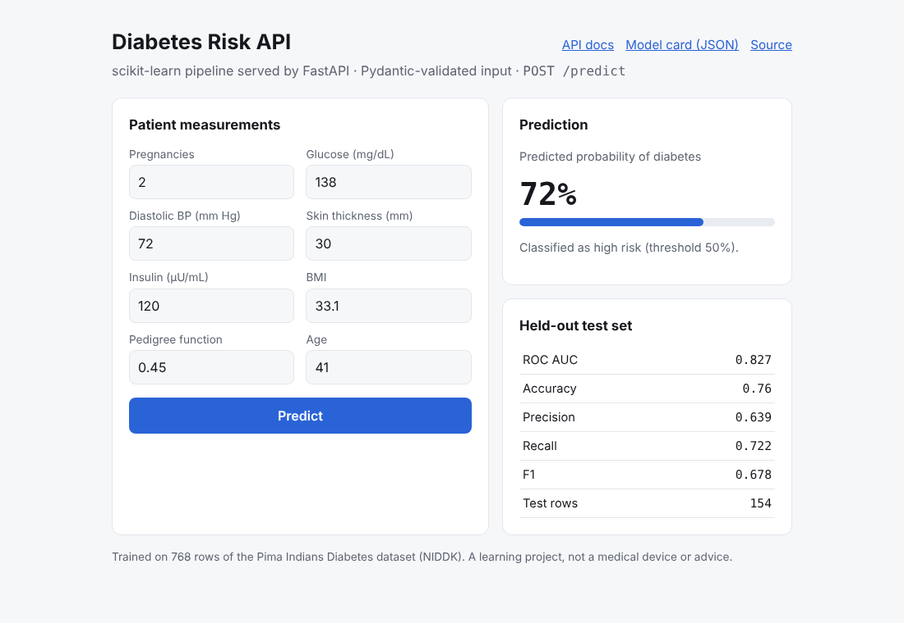

# Diabetes Risk API

[](https://github.com/NusratBegum/Diabetes-Prediction/actions/workflows/ci.yml)

A scikit-learn model for diabetes risk, served as a FastAPI service with validated input, a model card endpoint, tests and CI. It started as a notebook and Gradio demo and was rebuilt as a production-style model-serving API.

**Live demo:** https://diabetes-risk-api.vercel.app · **API docs:** https://diabetes-risk-api.vercel.app/docs



**Stack:** Python · FastAPI · Pydantic · scikit-learn · NumPy · pandas · pytest · GitHub Actions · Vercel

## Results

Random forest tuned with 5-fold stratified grid search on ROC AUC, evaluated once on a 20% held-out split (154 rows):

| Metric | Held-out test |
|---|---|
| ROC AUC | 0.827 |
| Accuracy | 0.76 |
| Precision | 0.639 |
| Recall | 0.722 |
| F1 | 0.678 |

Cross-validated ROC AUC on the training split was 0.838. Glucose, BMI and age carry the most weight. `GET /model` returns these numbers, the tuned hyperparameters and the full feature importance from `model/metrics.json`, which the training script writes.

## How it works

```
data/diabetes.csv ──▶ ml/train.py ──▶ model/model.joblib + model/metrics.json
                                            │
                            app/main.py (FastAPI) ──▶ POST /predict, GET /model, GET /
```

The model is a single scikit-learn `Pipeline`, so the API passes the eight raw measurements and all preprocessing happens inside it:

1. `ZeroToNaN`: in this dataset a 0 for glucose, blood pressure, skin thickness, insulin or BMI means "not measured", so those zeros become missing values.
2. `SimpleImputer(median)`: fills them with medians learned from the training rows only. The original notebook imputed before the train/test split, which leaks test information. Moving it into the pipeline fixes that.
3. `AddEngineeredFeatures`: BMI category, age group and glucose/insulin ratio.
4. `RandomForestClassifier` with balanced class weights (35% of rows are positive).

`app/features.py` holds the transformers, and training and serving share them, so the two can't drift apart.

## API

| Method | Path | Description |
|---|---|---|
| `POST` | `/predict` | Body: the eight measurements. Returns `probability`, `risk` (`high`/`low` at 0.5) and `model_version` |
| `GET` | `/model` | Model card: test metrics, best params, feature importance |
| `GET` | `/health` | Liveness check |
| `GET` | `/` | Web form for the API |

Input is validated by Pydantic with physiological ranges (for example glucose 0–250 mg/dL, age 21–100). Out-of-range or missing fields return `422`.

```bash
curl -X POST https://diabetes-risk-api.vercel.app/predict \
  -H "Content-Type: application/json" \
  -d '{"pregnancies":2,"glucose":138,"blood_pressure":72,"skin_thickness":30,"insulin":120,"bmi":33.1,"diabetes_pedigree":0.45,"age":41}'
```

## Run locally

```bash
python -m venv .venv && source .venv/bin/activate
pip install -r requirements-dev.txt
python -m ml.train                 # optional: retrain and rewrite model/
uvicorn app.main:app --reload      # http://localhost:8000
python -m pytest -v
```

## Project structure

```
.
├── app/
│   ├── main.py          # FastAPI routes
│   ├── schemas.py       # Pydantic request/response models
│   ├── features.py      # pipeline transformers shared by training and serving
│   └── static/index.html
├── ml/train.py          # reproducible training + metrics
├── model/               # model.joblib, metrics.json
├── data/diabetes.csv    # Pima Indians Diabetes dataset (768 rows)
├── notebooks/model.ipynb  # original exploratory notebook
├── tests/test_api.py
└── .github/workflows/ci.yml
```

## Data and limitations

The [Pima Indians Diabetes dataset](https://www.kaggle.com/datasets/uciml/pima-indians-diabetes-database) comes from the US National Institute of Diabetes and Digestive and Kidney Diseases. It covers 768 women aged 21 and over of Pima heritage, so the model will not generalise to other populations. This is a learning project and not a medical device. Don't use it for health decisions.

## Author

Nusrat Begum · [GitHub](https://github.com/NusratBegum) · [nusratbegum.dev](https://nusratbegum.dev)
